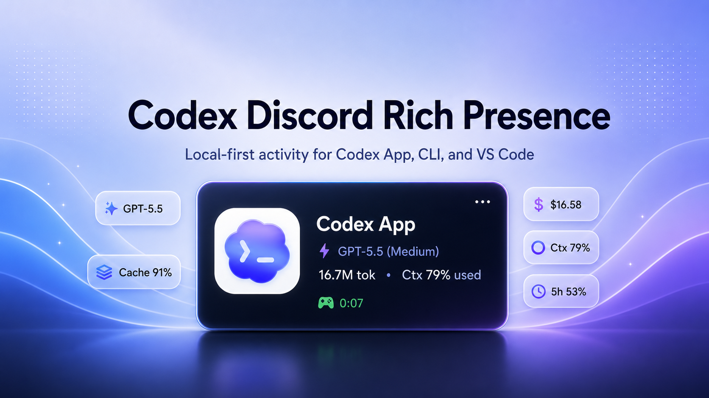
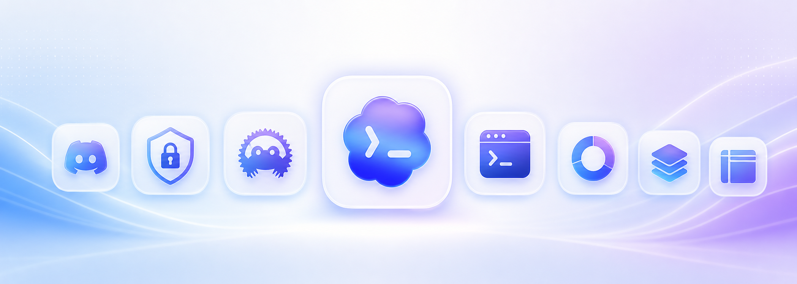

# Codex Discord Rich Presence

A local Rust runtime that publishes Codex activity to Discord and shows the same state in a terminal dashboard. One binary for Windows, macOS and Linux, with no analytics telemetry.

<div align="center">


[](https://github.com/xt0n1-t3ch/Codex-Discord-Rich-Presence/releases/latest)
[](LICENSE)

[Install](#installation) · [Features](#features) · [Controls](#terminal-controls) · [Configuration](#configuration) · [Documentation](docs/index.md)
</div>

## Overview

The runtime reads local Codex JSONL sessions and metadata. It can also read supported GPT sessions from OpenCode's local store. Session metadata has priority over launcher hints when identifying Codex App, ChatGPT App, CLI or VS Code activity.

The Discord identity remains Codex-owned. For a desktop analytics UI, arbitrary OpenCode providers and OpenCode Go account limits, use [Pulse](https://github.com/xt0n1-t3ch/Pulse-Analytics).

Release 1.11.3 adds GPT-6.1 Sol, GPT-6 Sol and GPT-6 Luna, bounds scanner memory and limits child-process lifetimes. Its shared `codex-presence-core` is 2.0.1, and configuration schema 13 remains compatible. See the [changelog](CHANGELOG.md) for release details and rollback notes.

## Preview



The foreground dashboard adapts to the terminal width. It uses a text wordmark, so no terminal image protocol is required. The [terminal UI guide](docs/ui/UI_SITEMAP.md) describes full, compact and minimal layouts.

## Features

| Data | Rule |
| --- | --- |
| Model and effort | Preserve the recorded model and supported observed effort |
| Speed | Explicit session speed wins over local fallback settings |
| Context | Use observed context before local model cache or catalog defaults |
| Cost | Keep exact, partial and unavailable states separate |
| Quotas | Preserve actual provider windows, scope and reset timestamps |
| Credits | Show only reported balances or explicit unlimited status |
| Privacy | Publish only the fields enabled in the local configuration |

A formatted `$0.00` is a rounded known amount, not a substitute for missing cost. Unpublished pricing and incomplete telemetry remain unavailable or partial.

### Terminal controls

| Key | Action |
| --- | --- |
| `P` | Choose automatic detection or a manual plan label |
| `D` | Switch the desktop identity between Codex App and ChatGPT App |
| `V` | Edit the visibility of presence fields |
| `M` | Pause or resume Discord publication |
| `Q` / `Ctrl+C` | Exit the foreground runtime |

Plan and presence settings persist in `~/.codex-discord-presence/config.json` (`CODEX_PRESENCE_HOME` moves the folder). Everything the program writes stays in that folder; the Codex home is only read, and no background process is started. Pausing publication does not stop local monitoring.

### Configuration

The runtime keeps configuration under `CODEX_HOME`, or `~/.codex` by default.

| Variable | Purpose |
| --- | --- |
| `CODEX_HOME` | Select a Codex home directory |
| `CODEX_PRESENCE_POLL_SECONDS` | Set the polling interval |
| `CODEX_PRESENCE_STALE_SECONDS` | Set the stale-session cutoff |
| `CODEX_PRESENCE_ACTIVE_STICKY_SECONDS` | Set the active-session retention window |
| `CODEX_PRESENCE_SURFACE` | Set a fallback surface: `cli`, `vscode` or `desktop` |
| `CODEX_PRESENCE_INCLUDE_WSL=1` | Opt in to WSL transcript discovery on Windows |
| `CODEX_PRESENCE_EFFICIENCY_MODE=0` | Opt out of Windows Efficiency mode before launch |

WSL scanning stays off unless requested. Surface overrides do not replace authoritative session metadata. See the [local schema](docs/database/schema.md) for configuration and snapshot fields.

On supported Windows versions, the runtime requests EcoQoS and Idle process priority for itself. It does not change the machine's power plan or another application's priority. Windows controls whether Task Manager displays a leaf indicator; other systems continue without this policy. See [Windows Efficiency mode](docs/windows-efficiency.md) for the read-only verifier and API contract.

## Supported surfaces

| Surface | Presence identity |
| --- | --- |
| Codex CLI | `Codex CLI` |
| Codex VS Code extension | `Codex VS Code Extension` |
| Codex desktop sessions | Selected `Codex App` or `ChatGPT App` design |
| Supported OpenCode-hosted GPT sessions | Codex-owned desktop identity |

Only Codex/OpenAI identities and assets publish. OpenCode support does not make this a general-purpose provider dashboard.

## Requirements

- The desktop Discord client, running and signed in, for Rich Presence publication.
- Local Codex sessions, or supported GPT sessions in OpenCode's local store.
- A terminal for the live dashboard.
- A matching release binary: Windows x64/ARM64, Linux x64, or macOS Intel/Apple Silicon.
- Rust 1.99.1 and a native linker only when building from source. Development checks also use cargo-nextest and cargo-audit.

Windows, macOS and Linux binaries are published. A native build or release smoke check does not imply every desktop environment has been manually tested.

## Installation

Download the matching binary from [GitHub Releases](https://github.com/xt0n1-t3ch/Codex-Discord-Rich-Presence/releases/latest). Verify it against the release's `SHA256SUMS.txt`. Windows releases also include architecture-specific SPDX software bills of materials.

### Windows

For x64, run in PowerShell:

```powershell
.\codex-discord-rich-presence-windows-x64.exe doctor
.\codex-discord-rich-presence-windows-x64.exe status
.\codex-discord-rich-presence-windows-x64.exe
```

Use `codex-discord-rich-presence-windows-arm64.exe` on ARM64. If a launcher hides the console, open Windows Terminal explicitly:

```powershell
wt -w new new-tab .\codex-discord-rich-presence-windows-x64.exe
```

### macOS

Choose `codex-discord-rich-presence-macos-arm64` for Apple Silicon or `codex-discord-rich-presence-macos-x64` for Intel. For Apple Silicon:

```sh
chmod +x codex-discord-rich-presence-macos-arm64
./codex-discord-rich-presence-macos-arm64 doctor
./codex-discord-rich-presence-macos-arm64
```

### Linux, including Arch and CachyOS

Use `codex-discord-rich-presence-linux-x64` on x86-64:

```sh
chmod +x codex-discord-rich-presence-linux-x64
./codex-discord-rich-presence-linux-x64 doctor
./codex-discord-rich-presence-linux-x64
```

Arch and CachyOS use the same binary; no AUR package is claimed. To build natively on Arch-based systems, install `base-devel`, Rust 1.99.1, `clang` and `mold`, then run `cargo build --release` from this repository. Source builds also support other targets with the matching Rust target and toolchain.

Keep Discord open for publication. The last command in each example opens the foreground dashboard; `status` and `doctor` are one-shot diagnostics.

### Commands

Use the downloaded filename in place of `codex-discord-rich-presence` below, or put it on your PATH under that name.

| Command | Purpose |
| --- | --- |
| `codex-discord-rich-presence` | Open the foreground dashboard |
| `codex-discord-rich-presence status` | Print one operational snapshot |
| `codex-discord-rich-presence doctor` | Check setup and runtime requirements |
| `codex-discord-rich-presence codex` | Run Codex as a child and follow its lifecycle |
| `codex-discord-rich-presence discord-proof` | Send and clear an activity, then print a sanitized Discord acknowledgement proof |

## Updating

Exit the runtime, verify the new release's checksum, replace the binary and run `doctor` before restarting. Read the [changelog](CHANGELOG.md) for configuration and core compatibility. Keep the previous executable if you need to roll back; do not assume an older binary understands a newer configuration schema.

## Removal

Exit the runtime to clear its activity, then remove the downloaded binary and any launcher you created. Configuration and metrics remain under `CODEX_HOME` or `~/.codex`; remove only the presence files you no longer need. Do not delete the Codex home directory, sessions or credentials to uninstall this runtime. See the [schema map](docs/database/schema.md) for owned file names.

## Project structure

```text
src/                         Runtime, CLI, Discord IPC, TUI and model catalog
crates/codex-presence-core/   UI-free usage and Discord composition contracts
xtask/                       Local checks and release tooling
assets/branding/             Codex/OpenAI visual assets
scripts/                     Platform-specific support tools
tests/integration/           Cross-module regressions
docs/                        Runtime, schema, UI and release guides
releases/                    Ignored local release outputs
```

## Development

Checks run locally; the GitHub release workflow is manual-only. Start with `cargo xtask check` before proposing a change.

| Task | Command |
| --- | --- |
| Full local gate | `cargo xtask check` |
| Format / check format | `cargo fmt --all` / `cargo fmt --all -- --check` |
| Lint | `cargo clippy --workspace --all-targets -- -D warnings` |
| Rust tests | `cargo nextest run --workspace` |
| Release-tool tests | `cargo nextest run -p xtask` |
| Release compile | `cargo build --release` |
| Build release artifacts | `cargo xtask build-release` or `cargo xtask build-release --target <triple>` |
| Assemble release assets | `cargo xtask release-assets` |
| Generate / check language-model docs | `cargo xtask llms` / `cargo xtask llms --check` |
| Validate changelog | `cargo xtask changelog check` |
| Extract changelog section | `cargo xtask changelog notes <version>` |
| Generate release body | `cargo xtask release-notes <version>` |
| Check / apply repository metadata | `cargo xtask meta --check` / `cargo xtask meta --apply` |
| Diagnostics from source | `cargo run -- status` / `cargo run -- doctor` |

The project uses [Semantic Versioning](https://semver.org/spec/v2.0.0.html), [Keep a Changelog](https://keepachangelog.com/en/2.0.0/) and [Conventional Commits](https://www.conventionalcommits.org/); see the [documentation index](docs/index.md), [test map](tests/index.md), [language-model map](llms.txt) and [contributing guide](CONTRIBUTING.md).

Read the [release procedure](docs/releasing.md) before creating a tag. Releases use annotated tags, an approved exact `main` commit and verified checksums. Published tags and assets are not replaced. A Windows cross-build alone does not prove native ARM64 execution.

## FAQ

### Does this upload my conversations?

No. It does not upload transcripts or send analytics telemetry. It publishes only the Discord fields you enable and performs the network requests required by its configured integration. Keep credentials and private prompts out of public issues. See [PRIVACY.md](PRIVACY.md) and report vulnerabilities through [GitHub Security Advisories](https://github.com/xt0n1-t3ch/Codex-Discord-Rich-Presence/security/advisories/new).

### Why is cost missing or partial?

Unknown pricing and incomplete request telemetry are unavailable, not zero. A known subtotal can be partial; snapshots retain coverage and provenance. See the [runtime contract](docs/api/codex-presence.md).

### Can I pause Discord without stopping monitoring?

Yes. Press `M` in the terminal. The switch persists, clears Discord activity and leaves local monitoring running. Press `M` again to publish the current state.

### Does this replace Pulse?

No. This is the terminal runtime for Codex-owned presence. [Pulse](https://github.com/xt0n1-t3ch/Pulse-Analytics) provides a desktop analytics UI and broader provider support.

## License

[MIT](LICENSE), copyright 2026 xt0n1-t3ch.
